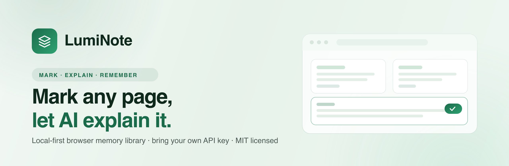
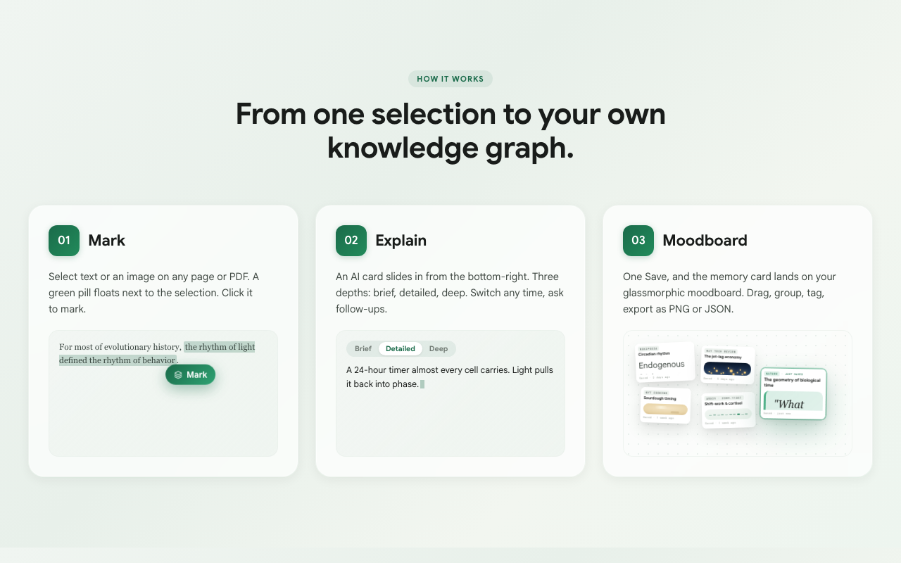
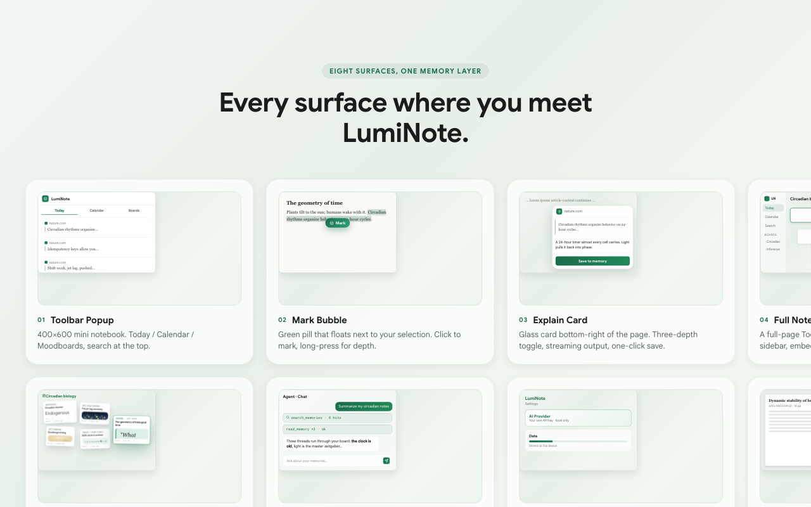
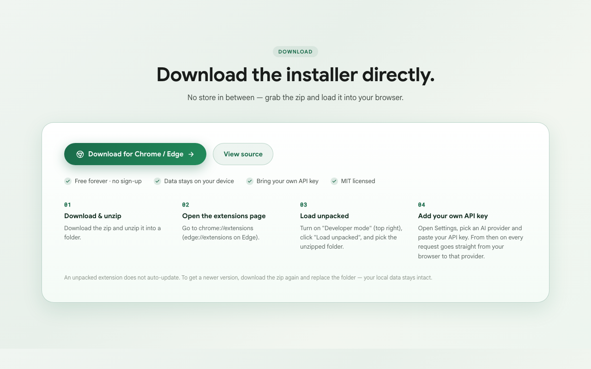

<div align="center">

<p>
  <a href="README.md"><b>English</b></a> ·
  <a href="docs/i18n/README.zh-CN.md">简体中文</a>
</p>



<br/>

<p>
  
  
  
  
</p>

<p>
  <b>Turn your browser into a memory library.</b><br/>
  Select text or an image on any page or PDF, let AI explain it in layers,<br/>
  then file it as a memory card you can return to anytime.
</p>

<p>
  <a href="https://chris00312.github.io/luminote/">
    
  </a>
  &nbsp;
  <a href="https://github.com/Chris00312/luminote/releases/latest">
    
  </a>
  &nbsp;
  <a href="#install">
    
  </a>
</p>

<p>
  <a href="#features"></a>
  <a href="#install"></a>
  <a href="#configure-ai"></a>
  <a href="#mcp-server"></a>
  <a href="#development"></a>
  <a href="LICENSE"></a>
</p>

</div>

---

## The problem it solves

You read something important, highlight it, have AI explain it, and get it. Then you close the tab — and three days later you can't remember where you saw it.

LumiNote does one simple thing: **it saves the exact spot you cared about, together with the understanding you built there** — and makes that memory readable by AI later.

It isn't a bookmark (URL only, you forget why), not a note (loses the original context), and not a highlight-translator (solves only the moment).

<div align="center">
  
  <br/>
  <sub><b>18-second demo</b> — mark, get a layered explanation, keep it on the board</sub>
</div>

<div align="center">
  
</div>

<br/>

## Features

<table>
<tr>
<td width="50%" valign="top">

### 🔍 Layered explanation
An AI card slides in from the bottom right with three depths: one-liner / detailed context / deep read. Switch anytime, ask follow-ups.

</td>
<td width="50%" valign="top">

### 🎯 Precise return
What you save isn't just text — it's the position in the original page. Come back and jump straight to that sentence.

</td>
</tr>
<tr>
<td valign="top">

### 🧊 Moodboard
Memory cards land on a glass canvas. Drag, group, tag, export as PNG or JSON.

</td>
<td valign="top">

### 🤖 Agent + MCP
A built-in Agent reads and writes your memory store. The same data is exposed over MCP to Claude Desktop and Cursor.

</td>
</tr>
<tr>
<td valign="top">

### 📄 Native PDF support
Self-hosted pdf.js — text selected inside a PDF can be explained, saved and revisited the same way.

</td>
<td valign="top">

### 🔐 Fully local
Everything is written to browser local storage. No account, no server, no telemetry.

</td>
</tr>
</table>

<div align="center">
  
</div>

<br/>

## Install

No app store needed. Download the zip and load it into your browser.

<div align="center">
  
</div>

**1. Download and unzip**

Grab the latest `luminote-vX.Y.Z.zip` from [**Releases**](https://github.com/Chris00312/luminote/releases/latest) and unzip it into a permanent folder.
> Don't delete that folder afterwards — the extension loads from it every time.

**2. Open the extensions page**

Go to `chrome://extensions` (or `edge://extensions` on Edge).

**3. Load the unpacked extension**

Turn on **Developer mode** in the top right, click **Load unpacked**, and pick the unzipped `luminote` folder.

**4. Add your own API key**

Click the extension icon → Settings, pick an AI provider and paste your key.

The UI ships in English and Simplified Chinese; switch under Settings → Language.

> **About updates**: an unpacked extension does not auto-update. To upgrade, download the new zip and replace the folder — your local data stays intact.

<br/>

## Configure AI

| Provider | Notes |
| :--- | :--- |
| **OpenAI / DeepSeek / compatible** | Any OpenAI-compatible endpoint; set base URL and model yourself |
| **Anthropic Claude** | Native Claude API |
| **Google Gemini** | Native Gemini API |
| **Volcengine 方舟** | Coding Plan, fixed `https://ark.cn-beijing.volces.com/api/coding/v3` |
| **MiniMax** | Token Plan, Anthropic-protocol compatible |
| **Aliyun 百炼** | Coding Plan, fixed `https://coding.dashscope.aliyuncs.com/v1` |

**Deep Think** (two-model cross-examination) and **Agent** (tool calling) can each use a second key; they fall back to the first one if you don't configure it.

<br/>

## MCP server

Let Claude Desktop, Cursor or any MCP client read and write your memory store.

```bash
npm install -g luminote-mcp-server
```

```json
{
  "mcpServers": {
    "luminote": {
      "command": "luminote-mcp",
      "args": []
    }
  }
}
```

It talks to the extension over a local WebSocket (`ws://127.0.0.1:19960`), so all data stays on your machine.

<br/>

## Development

The extension has **no build step** — edit the code, then hit the refresh button on its card in `chrome://extensions`.

```bash
git clone https://github.com/Chris00312/luminote.git
cd luminote
```

**Repackage the installer:**

```bash
node scripts/package-extension.mjs
# → website/downloads/luminote-chrome.zip (not tracked by git)
```

**Publish a release** (package + create a GitHub Release; requires `gh auth login`):

```bash
node scripts/release.mjs
```

**Preview the marketing site locally:**

```bash
python3 -m http.server 8000 --directory website
# open http://localhost:8000
```

**Regenerate the README screenshots** (needs `playwright-core` and a local Chrome):

```bash
python3 -m http.server 8765 --directory website
node scripts/generate-screenshots.mjs
```

**Regenerate the README header and badges** (needs `brew install librsvg`):

```bash
node scripts/generate-readme-assets.mjs
```

<details>
<summary><b>Repository layout</b></summary>

<br/>

```
LumiNote/                 The Chrome extension (MV3)
├── background/           Service worker: explain, PDF, memory API, context menus
├── content/              Content script: selection bubble, explain card
├── lib/                  AI providers, prompts, storage, i18n, agent engine
├── notebook/             Full notebook page (memory + moodboard + agent)
├── options/              Settings page
├── popup/                Toolbar popup
├── pdf-viewer/           Self-hosted pdf.js reader
├── welcome/              First-run onboarding
└── vendor/               Third-party libs (pdf.js, html2canvas)

website/                  Marketing site (static React + in-browser Babel)
├── components/           Section components + bilingual copy
└── assets/               Design tokens, logo, demo video

luminote-mcp-server/      MCP server
scripts/                  Packaging, release and asset-generation scripts
docs/                     README images (header, badges, screenshots)
design-system/            Design system and UI kit
```

</details>

<br/>

## Privacy

Every memory, moodboard and image is written to `chrome.storage.local`.

The extension collects nothing and uploads nothing. The only outbound requests go to the AI provider you configured; the only other connection is the local WebSocket to your own MCP client.

<details>
<summary>Full data flow</summary>

<br/>

| Data | Where it goes |
| :--- | :--- |
| Memories, moodboards, images | `chrome.storage.local` (this device only) |
| AI explanation requests | The provider you configured, directly from your browser |
| API key | `chrome.storage.sync` (your browser's own account sync — not us) |
| MCP calls | `ws://127.0.0.1:19960` (loopback only) |
| Telemetry / analytics | None |

</details>

<br/>

## Contributing

Issues and PRs are welcome. For anything larger than a typo, open an issue first so we can agree on the direction before you write code.

```bash
# Local checks
node scripts/package-extension.mjs        # packaging succeeds
node --check LumiNote/lib/*.js            # syntax is valid
```

<br/>

## License

[MIT](LICENSE) © 2026 LumiNote contributors

<br/>

<div align="center">
  <sub>Mark · Understand · Remember — on any page</sub>
</div>
