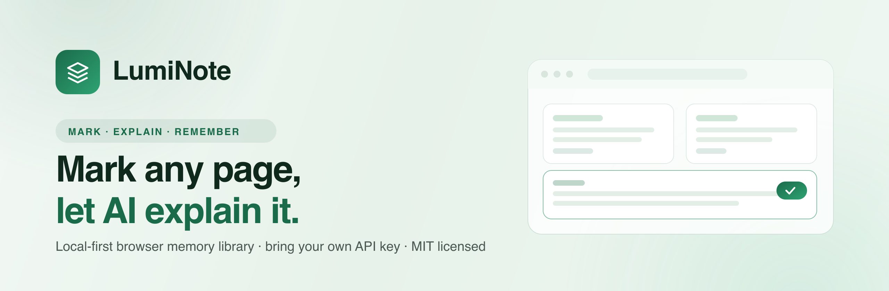
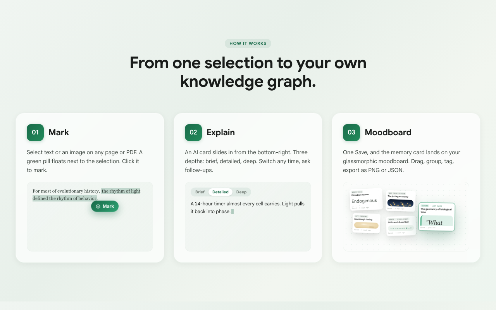
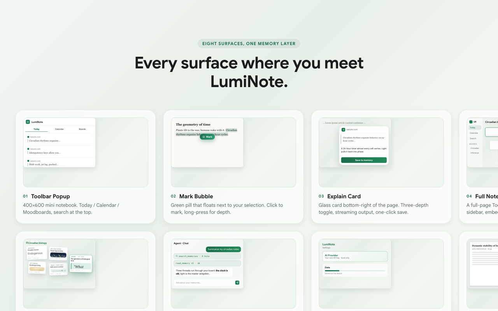
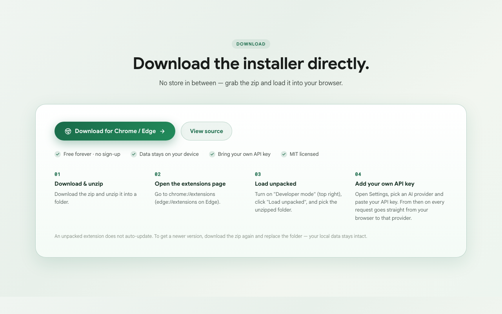

<div align="center">

<p>
  <a href="../../README.md">English</a> ·
  <a href="README.zh-CN.md"><b>简体中文</b></a>
</p>



<br/>

<p>
  
  
  
  
</p>

<p>
  <b>把你的浏览器变成一个记忆库。</b><br/>
  在任意网页或 PDF 上选中文字或图片，AI 分层解释它，<br/>
  然后把结果存成一张随时能回访的记忆卡。
</p>

<p>
  <a href="https://github.com/Chris00312/luminote/releases/latest">
    
  </a>
  &nbsp;
  <a href="#安装">
    
  </a>
</p>

<p>
  <a href="#功能"></a>
  <a href="#安装"></a>
  <a href="#配置-ai"></a>
  <a href="#mcp-服务器"></a>
  <a href="#开发"></a>
  <a href="../../LICENSE"></a>
</p>

</div>

---

## 它解决什么问题

你在网上读到一句重要的话，划词让 AI 解释了一下，理解了 —— 然后关掉页面，三天后想不起来在哪看到的。

LumiNote 做的事很简单：**把「你关注过的那个位置」连同当时的理解一起保存下来**，并且让 AI 以后能直接读到。

不是书签（只存 URL，忘了为什么存），不是笔记（失去原始上下文），也不是划词翻译（只解决当下）。

<div align="center">
  
  <br/>
  <sub><b>18 秒演示</b> — 划词，拿到分层解释，留在灵感板上</sub>
</div>

<div align="center">
  
</div>

<br/>

## 功能

<table>
<tr>
<td width="50%" valign="top">

### 🔍 分层解释
AI 卡片从页面右下角滑入，三层深度：一句话 / 详细语境 / 深度阅读。随时切换，可追问。

</td>
<td width="50%" valign="top">

### 🎯 精确回访
保存的不只是文字，还有它在原页面中的位置。下次回来直接跳回那句话。

</td>
</tr>
<tr>
<td valign="top">

### 🧊 灵感板
记忆卡落到玻璃质感画布上。拖拽、分组、打标签、导出 PNG / JSON。

</td>
<td valign="top">

### 🤖 Agent + MCP
内置 Agent 能读写你的记忆库。同一份数据也通过 MCP 暴露给 Claude Desktop、Cursor。

</td>
</tr>
<tr>
<td valign="top">

### 📄 原生 PDF 支持
自托管 pdf.js，PDF 里选中文字同样能解释、能保存、能回访。

</td>
<td valign="top">

### 🔐 全本地
数据只写在浏览器本地存储里。没有账号，没有服务器，没有遥测。

</td>
</tr>
</table>

<div align="center">
  
</div>

<br/>

## 安装

不需要应用商店。下载 zip，加载到浏览器里就行。

<div align="center">
  
</div>

**1. 下载并解压**

到 [**Releases**](https://github.com/Chris00312/luminote/releases/latest) 下载最新的 `luminote-vX.Y.Z.zip`，解压到一个固定的文件夹。
> 之后别删这个文件夹 —— 扩展要一直从它加载。

**2. 打开扩展管理页**

地址栏输入 `chrome://extensions`（Edge 用 `edge://extensions`）。

**3. 加载已解压的扩展**

打开右上角 **开发者模式**，点 **加载已解压的扩展程序**，选中刚解压出来的 `luminote` 文件夹。

**4. 填入你自己的 API Key**

点扩展图标 → 设置，选一个 AI 服务商，粘贴你的 Key。

界面提供英文和简体中文两种语言，可在 设置 → 语言 中切换。

> **关于自动更新**：以开发者模式加载的扩展不会自动更新。想升级时重新下载 zip 并覆盖原文件夹，本地数据不会丢失。

<br/>

## 配置 AI

| 服务商 | 说明 |
| :--- | :--- |
| **OpenAI / DeepSeek / 兼容** | 任意 OpenAI 兼容端点，自填 Base URL 与模型名 |
| **Anthropic Claude** | 原生 Claude API |
| **Google Gemini** | 原生 Gemini API |
| **火山方舟 Volcengine** | Coding Plan，固定 `https://ark.cn-beijing.volces.com/api/coding/v3` |
| **MiniMax** | Token Plan，兼容 Anthropic 协议 |
| **阿里云百炼 Aliyun** | Coding Plan，固定 `https://coding.dashscope.aliyuncs.com/v1` |

**Deep Think**（双模型交叉思考）和 **Agent**（工具调用）可以单独配第二组 Key；不配时复用第一组。

<br/>

## MCP 服务器

让 Claude Desktop、Cursor 或其他 MCP 客户端读写你的记忆库。

```bash
npm install -g luminote-mcp-server
```

```json
{
  "mcpServers": {
    "luminote": {
      "command": "luminote-mcp",
      "args": []
    }
  }
}
```

它通过本地 WebSocket（`ws://127.0.0.1:19960`）连到扩展，所有数据仍然留在你的机器上。

<br/>

## 开发

扩展本身**没有构建步骤** —— 改完代码，在 `chrome://extensions` 点扩展卡片上的刷新按钮即可。

```bash
git clone https://github.com/Chris00312/luminote.git
cd luminote
```

**重新打包安装包：**

```bash
node scripts/package-extension.mjs
# → website/downloads/luminote-chrome.zip（不进 git）
```

**发版**（打包 + 创建 GitHub Release，需先 `gh auth login`）：

```bash
node scripts/release.mjs
```

**本地预览官网：**

```bash
python3 -m http.server 8000 --directory website
# 打开 http://localhost:8000
```

**重新生成 README 截图**（需要 `playwright-core` 与本机 Chrome）：

```bash
python3 -m http.server 8765 --directory website
node scripts/generate-screenshots.mjs
```

**重新生成 README 页头与徽章**（需要 `brew install librsvg`）：

```bash
node scripts/generate-readme-assets.mjs
```

<details>
<summary><b>目录结构</b></summary>

<br/>

```
LumiNote/                 Chrome 扩展本体（MV3）
├── background/           Service worker：解释、PDF、记忆 API、右键菜单
├── content/              内容脚本：划选气泡、解释卡片
├── lib/                  AI 服务商、prompt、存储、i18n、Agent 引擎
├── notebook/             笔记本页（记忆库 + 灵感板 + Agent）
├── options/              设置页
├── popup/                工具栏弹窗
├── pdf-viewer/           自托管 pdf.js 阅读器
├── welcome/              首次安装引导
└── vendor/               第三方库（pdf.js、html2canvas）

website/                  官网（静态 React + 浏览器内 Babel）
├── components/           各区块组件 + 双语文案
└── assets/               设计 token、logo、演示视频

luminote-mcp-server/      MCP 服务器
scripts/                  打包、发版、素材生成脚本
docs/                    README 用图（页头、徽章、截图）
design-system/           设计系统与 UI kit
```

</details>

<br/>

## 隐私

所有记忆、灵感板、图片都写在 `chrome.storage.local`。

扩展不收集、不上传任何数据。唯一的外部请求是你自己配置的 AI 服务商；唯一的外部连接是本机 MCP 客户端的 WebSocket。

<details>
<summary>完整数据流</summary>

<br/>

| 数据 | 去向 |
| :--- | :--- |
| 记忆、灵感板、图片 | `chrome.storage.local`（仅本机） |
| AI 解释请求 | 你配置的服务商，浏览器直连 |
| API Key | `chrome.storage.sync`（你浏览器的账号同步，不经我们） |
| MCP 调用 | `ws://127.0.0.1:19960`（仅本机回环） |
| 遥测 / 分析 | 无 |

</details>

<br/>

## 参与贡献

Issue 和 PR 都欢迎。改动大一点的话，开 issue 先聊一下方向，避免白做。

```bash
# 本地验证
node scripts/package-extension.mjs        # 打包能过
node --check LumiNote/lib/*.js            # 语法检查
```

<br/>

## 许可证

[MIT](../../LICENSE) © 2026 LumiNote contributors

<br/>

<div align="center">
  <sub>标记 · 理解 · 记住 —— 在任何网页上</sub>
</div>
